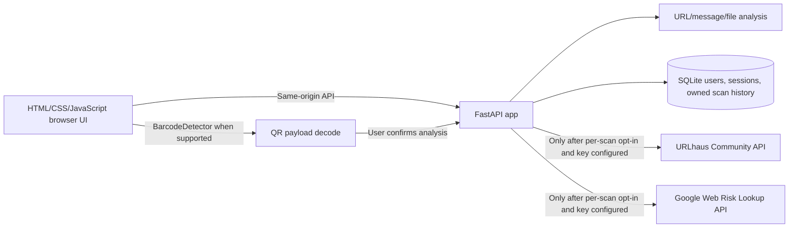

# Architecture

The application intentionally does not fetch submitted URLs or follow redirects. URLhaus and Web Risk receive a user-submitted URL only after a scan-level opt-in; message text, QR payment URIs, private-IP URLs, sensitive-token URLs, and bulk inputs are not sent. Provider calls use backend-only credentials, bounded timeouts/retry, and short result caching. Uploaded files are processed in memory; ZIP metadata is read without extracting entries.

Authentication uses salted scrypt password hashes and opaque server-side sessions in SQLite; the browser receives an HttpOnly, SameSite cookie and uses a CSRF token for state-changing requests. Report and history routes filter by account ownership. Schema versions 1 and 2 create auth/session tables and add scan ownership. SQLite is not encrypted at rest and local auth has not received independent security review. The Docker Compose port is loopback-only. Public hosting still needs TLS/deployment review, distributed rate limiting, egress policy for any future redirect worker, durable monitoring, backups/restore testing, and a deployment-specific threat model.
