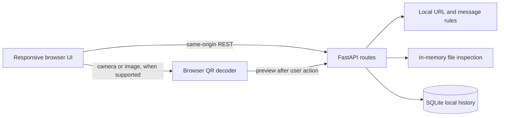

# LinkGuard

LinkGuard is a responsive, India-focused scam-awareness application with a FastAPI backend. It checks user-submitted links for local warning patterns, reviews message text for common scam pressure, previews QR payloads, fingerprints files, and assembles readable evidence reports.

**This is a working local security/provider preview, not a production-certified security scanner.** URLhaus and Google Web Risk checks are optional and only run when a server key is configured and the user opts in. LinkGuard does not open submitted URLs, scan files with antivirus, identify senders, or verify payees. Its numeric value is an uncalibrated rule indicator, not a probability. `Scan incomplete` means required checks were unavailable; it must never be read as safe.

## Features

- Responsive dark/light UI, reduced-motion support, and English/Tamil/Hindi language selector (the scan interface and report content are currently English; translations are partial).
- URL structure checks, IDN/Punycode indicator, IP literal and non-public IP warning, link-shortener warning, and suspicious phrase/query parameter clues. Submitted URLs are never fetched.
- Message pattern checks and URL/phone extraction. Raw message text is processed in memory and not written to history; extracted URLs and phone numbers are excluded from the persisted report.
- QR image decoding through the browser BarcodeDetector when supported, optional camera scan, preview before analysis, and basic UPI payload display. No automatic redirect/payment.
- File size limit, in-memory SHA-256, and basic PDF/ZIP/APK signature and archive metadata checks. No file execution or antivirus scan.
- Batch check of up to 25 links with individual errors and CSV export.
- Timestamped evidence timelines, observed-only message indicator graph, and JSON report export.
- Emergency response guide with official Indian cybercrime and NPCI source links.
- Optional, explicit-consent URLhaus and Google Web Risk URL lookups when backend keys are configured; sensitive-token URLs and private IPs are skipped. Providers have explicit status, timeout/retry handling, five-minute caching, and health state.
- Request IDs, baseline security headers, a single-process scan rate limit, and localhost-only Docker port mapping.
- Versioned scam coverage taxonomy in `app/scam_taxonomy.v1.json`, with each category clearly marked as limited-rule coverage or not implemented.
- Explicit scan execution statuses and verdict basis; unavailable checks produce `Scan incomplete` where no warning evidence exists. Rule indicators and qualitative confidence are marked as uncalibrated.
- User accounts with scrypt password hashes, opaque HttpOnly/SameSite sessions, CSRF checks, account deletion, and per-user SQLite report history (up to 500 per account). This is a local single-instance account system, not an identity service.
- Versioned synthetic message dataset split into train/validation/test; only the 12-sample test split is measured. Results are documented as synthetic regression evidence, never real-world accuracy.
- Scam guide and synthetic single-question safety practice.
- API docs at `/docs` when running locally.

## Run locally

Requires Python 3.10 or newer.

```powershell
python -m venv .venv
.\.venv\Scripts\Activate.ps1
pip install -r requirements.txt
uvicorn app.main:app --reload
```

Open `http://127.0.0.1:8000`. The SQLite database is created as `linkguard.db` in the project root. Set `LINKGUARD_DB` to change its location. `LINKGUARD_MAX_FILE_BYTES` defaults to 10 MiB. `LINKGUARD_CORS_ORIGINS` is a comma-separated allowlist; keep it restricted to the deployed frontend origin.

Register an account in the website before scanning. For URLhaus, set `URLHAUS_AUTH_KEY`; for Google Web Risk, set `WEBRISK_API_KEY`. A user must still opt in on each URL/QR scan. The full submitted URL, including path and query but excluding fragment, is sent to configured providers; token-like query parameters and private IP literals are skipped. Review provider terms and cost before enabling them. Google Safe Browsing and VirusTotal public API are not integrated because of their public API restrictions; details are in `THREAT_INTELLIGENCE_REVIEW.md`.

Camera access requires HTTPS or localhost and a supported browser. If `BarcodeDetector` is unavailable, upload-based QR decoding is unavailable too; install a reviewed decoder before enabling broader support.

## Docker

```sh
docker compose up --build
```

The compose setup stores SQLite data in the named `linkguard-data` volume. Before hosted use, set `LINKGUARD_COOKIE_SECURE=true`, terminate HTTPS at a trusted reverse proxy, set exact CORS origins, and configure backups, monitoring, password reset/account recovery, email verification, and operational controls. The database remains SQLite; deployment review is still required before allowing untrusted public traffic.

## API overview

| Method | Endpoint | Purpose |
|---|---|---|
| GET | `/api/v1/health` | Service status and explicit external-provider status |
| GET | `/api/v1/config` | Public feature availability and configured size limits; never returns secrets |
| POST | `/api/v1/auth/register` | Create an account and secure session |
| POST | `/api/v1/auth/login` | Start a session |
| GET | `/api/v1/auth/me` | Current account and CSRF token |
| POST | `/api/v1/auth/logout` | Revoke current session (CSRF header required) |
| DELETE | `/api/v1/auth/account` | Delete current account and its reports (CSRF header required) |
| POST | `/api/v1/scan/url` | Local URL structure analysis (`{"url":"https://example.com"}`) |
| POST | `/api/v1/scan/message` | Local phrase-pattern analysis (`{"message":"..."}`) |
| POST | `/api/v1/scan/qr` | Analyse a decoded QR payload; accepts URL or UPI URI in `url` |
| POST | `/api/v1/scan/file` | In-memory file fingerprint and basic signature check (multipart `file`) |
| POST | `/api/v1/scan/bulk` | Up to 25 independently checked URLs (`{"urls":[...]}`) |
| GET | `/api/v1/scam-categories` | Versioned scam taxonomy and honest per-category coverage status |
| GET | `/api/v1/emergency-guides` | Response guidance with official source URLs |
| GET | `/api/v1/history` | Local saved reports (`?limit=50`) |
| GET | `/api/v1/reports/{id}` | Retrieve a report |
| DELETE | `/api/v1/history/{id}` | Delete a saved report |
| DELETE | `/api/v1/history` | Clear all saved reports |

Example:

```sh
curl -X POST http://127.0.0.1:8000/api/v1/scan/url \
  -H 'Content-Type: application/json' \
  -d '{"url":"https://example.com"}'
```

## Data and privacy

- URL checks are local. Neither server nor browser follows submitted links. URL query strings are not retained; reports retain the hostname, findings, and timestamp.
- Message content is not retained. Reports omit extracted URLs and phone numbers in history; generic matched pattern evidence may remain.
- Files are read into memory, hashed, and not written to disk. Upload size is capped.
- QR payload content is shown in the browser for review; analysed reports may be saved. Treat QR reports as potentially sensitive and delete them when finished.
- History is stored in the local SQLite database, is not encrypted at rest, and is now isolated by account. Legacy records without an owner remain inaccessible to authenticated accounts.
- No external service receives URLs unless a provider key is configured and the user explicitly opts in on that scan. Message content remains local. No analytics are included.

## Architecture



## Security boundaries and limitations

- URL scans do not make outbound connections, which avoids turning the API into an SSRF proxy. Redirect, DNS, TLS, RDAP, and reputation checks are not implemented.
- No API secrets are included. URLhaus is optional and requires a server-side Auth-Key and explicit per-scan consent. Other provider integrations remain unavailable pending terms, consent/data-flow review, credentials, timeouts, caching, and provider-specific unknown/error states.
- This release now has password hashing, server-side opaque sessions, CSRF token checks, and per-account report authorization. It has no email verification, password reset, MFA, account lockout recovery, or independent auth security review. The in-memory rate limiter is single-process only and does not protect multiple workers or hosts.
- The numeric rule indicator is not calibrated and must not be represented as scam probability. See `DETECTION_ACCURACY_REPORT.md`, `FALSE_POSITIVE_REPORT.md`, and `FALSE_NEGATIVE_REPORT.md` for actual evaluation status (currently not measured).
- Tamil/Hindi translations are partial; security warnings and report details remain in English until professionally reviewed translations are added.
- No accuracy or detection coverage claim is made. URLhaus cannot be live-verified without a valid key and consent. No production deployment has been performed.

## Next work for a production release

1. Add PostgreSQL deployment, migration tooling, retention/backup jobs, password reset, MFA, verified identity flow, and account abuse controls for hosted use.
2. Add distributed rate limits, structured redacted logs, monitoring, independent security review, and production HTTPS verification.
3. Commission review of local detection rules and all Tamil/Hindi security copy; establish a sourced, dated content governance workflow.
4. Run live provider checks only after provisioning keys; implement operational alerts for repeated provider downtime and verify account-restricted cloud keys.
5. Add a maintained QR decoder fallback and safe APK manifest parser; do not execute uploaded content.
6. Create a permitted, labelled evaluation dataset and report measured false positives/negatives before making detection claims.
