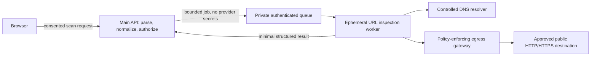

# URL Inspection Worker Threat Model

**Status: Design only. No DNS lookup, redirect following, or user-submitted URL fetch is implemented.** The current FastAPI process parses the URL locally and may contact only fixed threat-intelligence provider endpoints after consent. Do not turn on arbitrary fetch behavior in the API process.

## Trust boundaries and proposed topology

The API must never open a socket to a user-supplied hostname. The worker must run as a separate service/container under a distinct OS identity, with a read-only root filesystem, no host mounts, no Docker socket, no cloud metadata credentials, no shared database credentials, and no provider API keys. Jobs use a short-lived ID and consent record; the queue and result channel are private, authenticated, schema-limited, and size-bounded.

## Egress boundary

- Deny all network egress by default. Permit DNS only to the controlled resolver and HTTP/HTTPS only through an egress gateway that enforces destination IP policy at connection time.
- Do not honor `HTTP_PROXY`, `HTTPS_PROXY`, `ALL_PROXY`, `NO_PROXY`, PAC files, or environment-derived proxy behavior from the job.
- Restrict ports to 80 and 443 unless a separately reviewed product requirement exists. Block SMTP, SSH, database, admin, and cloud-control ports.
- The gateway and worker must independently check the destination; application-level validation alone is not an egress control.
- Do not include provider credentials in the worker job or target request.

## SSRF and address policy

1. Accept only normalized `http` and `https` URLs with a valid host. Reject userinfo, invalid ports, control characters, ambiguous numeric host encodings, zone identifiers, malformed IPv6 literals, and unsupported schemes.
2. Resolve A and AAAA records through the controlled resolver. Follow and record CNAMEs with a strict count/depth. Reject the destination if **any** candidate answer is not globally routable; do not select a public answer while ignoring a private answer.
3. Block IPv4 loopback, private, link-local, shared address space, documentation, benchmark, multicast, reserved, broadcast, and unspecified ranges, including `169.254.169.254` and provider metadata networks. Block IPv6 loopback, unique-local, link-local, multicast, unspecified, documentation, reserved/special-purpose ranges, IPv4-mapped IPv6 that maps to a blocked IPv4 range, transition/tunneling forms, and scoped/zone addresses.
4. Use an explicit maintained IANA special-purpose CIDR policy in addition to the runtime `is_global` check. IP classification can change with runtime registry versions; pin and review the policy data.
5. Pin the selected validated IP into the connection operation. Preserve the original normalized hostname for HTTP `Host`, TLS SNI, and certificate hostname validation. Verify the connected peer IP equals a validated pinned address before sending HTTP data.
6. Re-resolve and revalidate on every new connection and every redirect. If DNS answers change during the job, discard stale answers and restart validation. Never let an HTTP library silently re-resolve after validation.

## DNS rebinding and redirect rules

- DNS is untrusted and may change between answers. Resolve once per connection attempt, validate all answers, pin one accepted public IP, connect to that IP, and check the peer address. Do not validate DNS in one component and let another component resolve by hostname later.
- Disable automatic redirect handling. Parse each `Location` as a new untrusted URL, resolve it again, reapply scheme/host/IP rules, and pin the next connection. Maximum **5 redirects**; detect loops and reject downgrade from HTTPS to HTTP unless a product policy explicitly permits it.
- Reject redirects to credentials-bearing URLs, unsupported schemes, non-public literals, or hosts outside a deny/allow policy. Do not forward cookies, Authorization, Referer, or user-supplied headers between hops.
- Recheck TLS certificate hostname and validity on every HTTPS hop. Never disable certificate validation.

## Resource limits and content handling

- Connect timeout: 2 seconds. TLS handshake timeout: 2 seconds. Read idle timeout: 2 seconds. Total worker job deadline: 10 seconds. These are initial defaults to load-test and tune.
- Maximum 5 redirects and maximum 256 KiB total response bytes. Stream into a bounded sink and abort immediately when the limit is exceeded. Do not decompress unbounded bodies; if decompression is ever necessary, cap both compressed and expanded bytes and expansion ratio.
- Initially use a request mode that minimizes content retrieval (for example, bounded headers/limited range) and treat servers that ignore limits as truncated/unavailable. Never render HTML, execute JavaScript, load subresources, download executables, or open returned content in a browser.
- Limit concurrent jobs, DNS queries, sockets, file descriptors, memory, CPU, and worker lifetime. Kill and replace a worker after the deadline or protocol violation.

## Errors, privacy, and logs

- Return fixed structured statuses such as `completed`, `blocked_private_address`, `redirect_limit`, `timeout`, `dns_error`, `tls_error`, `response_too_large`, and `unavailable`; never translate a failed/blocked check into “safe”.
- Show only a concise explanation and the actual check status. Do not return stack traces, resolver internals, proxy details, or infrastructure addresses to the user.
- Do not log full URLs, query strings, fragments, cookies, headers, page bodies, credentials, or DNS answers tied to a user. Log a random job ID, policy outcome, coarse elapsed time, byte count, redirect count, and error class. Restrict and expire operational logs.
- Because the worker contacts the destination, the destination can observe the worker's egress IP. Require clear user consent before this future behavior and document that the site may receive a scan request.
- Keep report retention, consent record, and deletion semantics aligned. Do not store downloaded page contents.

## Required security test matrix before enabling worker fetches

No worker exists yet, so these are planned tests, not passed tests:

- IPv4 and IPv6 special-purpose range table tests, including mapped IPv4, NAT64/transition, scoped IPv6, metadata service, and unusual numeric forms.
- DNS answers with only private IP, mixed public/private answers, CNAME to private, CNAME loop/depth, timeout, NXDOMAIN, and rebinding between validation and connection.
- Connector tests proving the network peer matches the pinned address and that the HTTP library cannot re-resolve or follow redirects automatically.
- Redirect chains to private IP, metadata IP, alternate scheme, credentials URL, loop, downgrade, and more than five hops.
- TLS hostname mismatch, expired certificate, self-signed certificate, and invalid chain.
- Slow headers/body, infinite stream, oversize body, compressed bomb, and worker deadline tests.
- Egress firewall tests proving arbitrary ports, local networks, host network, metadata endpoint, and API database are unreachable.
- Log/trace tests proving URL query, credentials, response body, and DNS details are absent.
- Worker crash/restart, queue authentication, duplicate job, cancellation, and cross-user result binding tests.

**Gate:** Phase 3A remains local-only. A separate architecture/security review and passing worker SSRF matrix are required before any redirect/DNS fetch code is merged or enabled.
